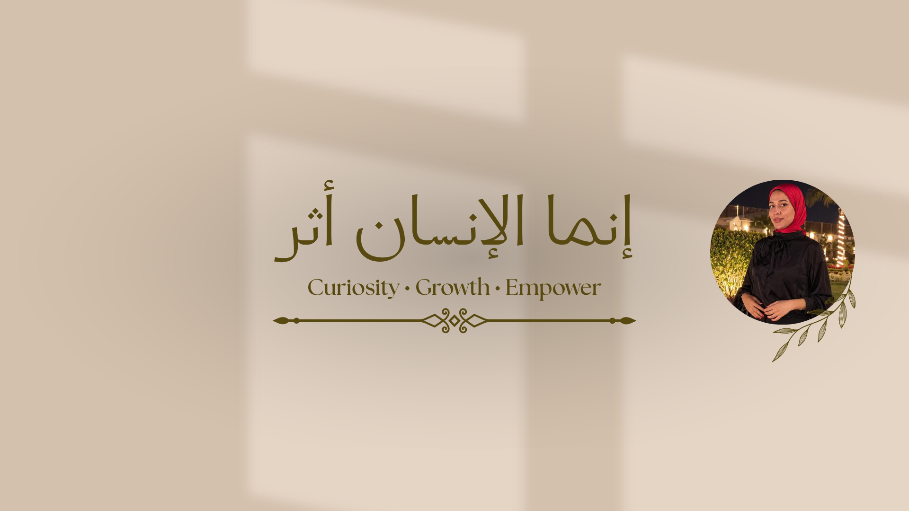

  

# Hi, I'm Haidy Mohamed Abdelfattah 💗

### Computer Science Student | Aspiring Software Developer | Ain Shams University

I'm a Computer Science student at the Faculty of Computer and Information Sciences, Ain Shams University, with a strong academic background and a passion for software development, problem-solving, and continuous learning.

I enjoy exploring different areas of technology, from building mobile and web applications to working with databases, analyzing data, and exploring Artificial Intelligence.

Beyond coding, I enjoy sharing knowledge, mentoring beginners, working with teams, and transforming complex technical concepts into understandable ideas.

💗 **Currently:** Studying Computer Science at Ain Shams University  
🦋 **Academic GPA:** 3.65 / 4.0  
✨ **Main Interests:** Software Development, Flutter, Front-End Development, Data Science & AI  
💖 **Community:** Vice Head & Instructor of the Flutter Track at Open Source Community (OSC)  
🥀 **Based in:** Cairo, Egypt

---

# 💗 Technical Skills & Expertise

I have worked with different programming languages, frameworks, databases, and development tools through academic coursework, internships, personal projects, and practical training.

## 1. Programming Languages

| Technology | Knowledge & Experience |
|---|---|
| C++ | Object-Oriented Programming, Data Structures, File Handling, Problem Solving |
| Java | Object-Oriented Programming and Core Programming Concepts |
| C# | Object-Oriented Programming, Windows Forms, Application Development |
| Dart | Object-Oriented Programming, Flutter Development, Asynchronous Programming |
| JavaScript (ES6) | DOM Manipulation, Modern JavaScript, Application Logic |
| TypeScript | Type Safety, Interfaces, React Development |
| Python | Data Analysis, Data Cleaning, Exploratory Data Analysis, Machine Learning |
| SQL | Relational Databases, DDL, DML, Queries, Database Design |

## 2. Mobile Development

**Flutter & Dart**

- Developing cross-platform mobile application interfaces using Flutter.
- Building reusable widgets and structured UI components.
- Understanding Stateful and Stateless Widgets.
- Working with navigation, layouts, themes, and responsive interfaces.
- Applying Object-Oriented Programming principles in Dart.
- Working with forms, user input, and application logic.
- Exploring state management and application architecture.
- Familiar with Firebase integration through collaborative project work.

**Related Experience:** Flutter Track Instructor at Open Source Community (OSC).

## 3. Front-End Web Development

**React.js, JavaScript, TypeScript, HTML5 & CSS3**

- Building component-based user interfaces with React.js.
- Understanding React Hooks and state management.
- Working with props, components, and reusable UI structures.
- Implementing interactive web applications.
- Managing application state and browser Local Storage.
- Developing responsive layouts using HTML5 and CSS3.
- Styling interfaces with Tailwind CSS.
- Translating UI designs and Figma concepts into functional web pages.
- Building interactive applications with React and TypeScript.

**Related Experience:** ITI React.js Internship, 144 training hours.

## 4. Databases & Database Development

**Oracle SQL, SQL Developer, Oracle Forms Builder & ODP.NET**

- Relational Database Management Systems (RDBMS).
- Database design and relational modeling.
- Primary Keys, Foreign Keys, Constraints, and Relationships.
- Database normalization concepts.
- DDL and DML operations.
- Writing SQL queries and managing relational data.
- Working with master-detail relationships.
- Implementing triggers, alerts, and List of Values (LOVs).
- Understanding Connected and Disconnected Data Access using ODP.NET.
- Integrating database operations with C# applications.
- Generating reports using Crystal Reports.

**Related Projects:** Magazine Management Database System and Library Management System.

## 5. Data Science & Machine Learning

**Python, Pandas, Matplotlib, Seaborn & Machine Learning**

- Data preprocessing and cleaning.
- Handling missing values.
- Exploratory Data Analysis (EDA).
- Feature engineering and feature creation.
- Data visualization and statistical exploration.
- Correlation analysis and heatmaps.
- Analyzing patterns and relationships within datasets.
- Understanding supervised machine learning concepts.
- Building and evaluating predictive models through team-based training.

**Related Projects:**
- StayPredict: Hotel Booking Cancellation Prediction.
- Titanic Survival: Exploratory Data Analysis.

## 6. Software Engineering & System Analysis

- Object-Oriented Analysis and Design.
- Software Requirements Specification (SRS).
- Functional and Non-Functional Requirements.
- Requirements Gathering and Analysis.
- Use Case Diagrams.
- Sequence Diagrams.
- System Design and Modeling.
- Understanding application workflows and business logic.
- Translating requirements into software functionality.
- Software Quality and maintainability concepts.

## 7. Development Tools & Technologies

- Git and GitHub for version control and source code management.
- Visual Studio and Visual Studio Code.
- Oracle SQL Developer.
- Oracle Forms Builder.
- Crystal Reports.
- Firebase.
- Figma for UI design reference and implementation.

---

# 🦋 Professional Experience

## Telesales Specialist (B2C)
**ACES Contact Center | March 2026 – October 2026**

Worked in an English-speaking telesales environment, communicating with senior customers across more than 48 U.S. states and serving as a main point of contact for a medical provider.

**Responsibilities & Achievements:**

- Conducted customer conversations entirely in English.
- Presented products and offers in a clear and professional manner.
- Handled customer objections, inquiries, and concerns.
- Built trust and maintained professional relationships with customers from different backgrounds.
- Developed persuasive communication and negotiation techniques.
- Worked in a fast-paced, target-driven sales environment.
- Successfully contributed to more than 40 sales.

**Skills Developed:** Active Listening, Persuasion, Negotiation, Problem Solving, Customer Relationship Management, Professional Communication, and Working Under Pressure.

## English Assistant
**Private English Teacher | 2024 | 6+ Months**

Assisted my former private English teacher in delivering lessons and supporting students throughout their English-learning journey.

**Responsibilities:**

- Assisted in preparing and delivering English lessons.
- Helped students improve their speaking abilities and vocabulary.
- Supported learners in developing confidence when communicating in English.
- Explained concepts and provided additional practice.
- Helped create a supportive and interactive learning environment.

**Skills Developed:** Teaching, Mentoring, Communication, Patience, and Knowledge Sharing.

---

# 💖 Leadership & Community Involvement

## Vice Head & Instructor | Flutter Track
**Open Source Community (OSC), Ain Shams University | April 2026 – Present**

Actively involved in the technical and educational activities of the Flutter track, helping students develop their programming foundations and begin their mobile development journey.

**Leadership & Responsibilities:**

- Participate in leading and coordinating the Flutter track.
- Interview first-year and second-year university students to assess their technical foundations and select suitable candidates.
- Teach Object-Oriented Programming concepts as a prerequisite for the Flutter learning track.
- Introduce students to Dart programming and its fundamental concepts.
- Teach Flutter fundamentals and mobile application development.
- Break down complex technical concepts into simple, understandable explanations.
- Support students during their learning journey and help them overcome technical challenges.
- Collaborate with other community members to organize educational activities.

**Areas of Teaching:**

1. Object-Oriented Programming (OOP).
2. Dart Programming Language.
3. Flutter Framework Fundamentals.
4. Mobile Application Development.

**Skills Developed:** Leadership, Technical Instruction, Mentoring, Interviewing, Team Coordination, Public Speaking, and Technical Communication.

---

# ✨ Education

## Bachelor of Computer and Information Sciences
**Ain Shams University | Expected Graduation: 2028**

- Major: Computer Science.
- Cumulative GPA: 3.65 / 4.00.

**Relevant Coursework:**

- Data Structures & Algorithms.
- Object-Oriented Programming (C++ and Java).
- Database Management Systems (DBMS).
- Software Engineering.
- System Analysis and Design.
- Computer Networks.
- Operating Systems.
- Compiler Design.
- Data Mining.
- Web and Mobile Application Development.
- Artificial Intelligence and Machine Learning Fundamentals.

---

# 🥀 Training & Internships

## Generative AI Internship
**Commercial International Bank (CIB) | 1 Month**

Completed a training program exploring Generative AI and its applications within the banking industry.

**Areas Explored:**

- Generative AI fundamentals and applications.
- AI use cases in banking and financial services.
- Customer Experience (CX).
- Digital Banking.
- Banking Controls and Processes.
- Data Analytics.
- Cybersecurity and Machine Learning concepts.
- Emerging technologies in financial services.

## React.js Internship
**Information Technology Institute (ITI) | 144 Hours | 1 Month**

Completed intensive React.js training focused on modern front-end development.

**Areas Covered:**

- JavaScript and modern ES6 concepts.
- React components and reusable UI structures.
- React Hooks.
- State and Props.
- Component-based application development.
- TypeScript fundamentals.
- Building interactive web applications.

## Data Science & Machine Learning Training
**Students for Egypt | Ain Shams University | Summer 2026**

Participated in a practical Data Science and Machine Learning training program, collaborating with a team of five students on a predictive analytics project.

**Areas Covered:**

- Python for Data Science.
- Data preprocessing and cleaning.
- Exploratory Data Analysis.
- Feature Engineering.
- Machine Learning fundamentals.
- Predictive Model Development.
- Model Evaluation.

**Team Project:** StayPredict, Hotel Booking Cancellation Prediction.

---

# 🦋 Technical Projects

A collection of academic, personal, and collaborative projects demonstrating my experience across different technologies.

## 1. Flutter CRUD Student Application

**Technologies:** Flutter, Dart

A student management application focused on implementing CRUD operations and understanding the fundamentals of mobile application development.

**Key Concepts:**
- Flutter UI development.
- Dart programming.
- User input and application logic.
- Create, Read, Update, and Delete operations.

[View Repository](https://github.com/haidymuhamad/flutter_crudcrud_student_app)

## 2. Titanic Survival | Exploratory Data Analysis

**Technologies:** Python, Pandas, Seaborn, Matplotlib

An exploratory data analysis project investigating the factors associated with passenger survival in the Titanic dataset.

**Key Features:**
- Data cleaning and preprocessing.
- Handling missing values.
- Feature engineering.
- Creating Family Size and Alone/With Family features.
- Age Group analysis.
- Survival analysis by gender, passenger class, age, and fare.
- Correlation heatmap and data visualizations.

[View Repository](https://github.com/haidymuhamad/titanic-eda-python)

## 3. StayPredict | Hotel Booking Cancellation Prediction

**Technologies:** Python, Data Science, Machine Learning

A collaborative machine learning project developed during the Students for Egypt training program.

**Project Overview:**
- Worked in a team of five students.
- Processed and cleaned hotel booking data.
- Explored patterns related to booking cancellations.
- Applied feature engineering and predictive modeling.
- Worked on evaluating the predictive model.

## 4. Library Management System

**Technologies:** C#, ODP.NET, Oracle Database, Crystal Reports

A Software Engineering academic project focused on developing a library management application.

**Key Contributions:**
- Authored a Software Requirements Specification (SRS).
- Identified functional and non-functional requirements.
- Designed Use Case and Sequence Diagrams.
- Implemented application functionality using C#.
- Integrated Oracle database operations using ODP.NET.
- Used Crystal Reports to generate reports and summarize information.

## 5. Magazine Management Database System

**Technologies:** Oracle SQL, SQL Developer, Oracle Forms Builder

A database-oriented academic project involving the design and implementation of a relational database and its user interface.

**Key Features:**
- Relational database design.
- SQL queries and database operations.
- Triggers and alerts.
- Master-detail relationships.
- List of Values (LOVs).
- Calculated fields.
- Oracle Forms user interface.

## 6. Furniture Management System

**Technologies:** C++, Windows Forms, File Handling, Data Structures

An academic application designed to manage furniture inventory and customer orders.

**Key Features:**
- Stock management.
- File handling and data persistence.
- Application logic using C++.
- Data structure implementation.
- Administrative dashboard.
- Customer information and order status management.

## 7. To-Do List Application

**Technologies:** React.js, JavaScript

An interactive task management application designed to organize daily tasks and improve productivity.

**Key Features:**
- Create and manage tasks.
- Task categories.
- Due dates.
- Local Storage integration.
- Dark and Light Mode.
- Interactive React components.

## 8. Tic-Tac-Toe

**Technologies:** React.js, TypeScript

An interactive implementation of the classic Tic-Tac-Toe game using React and TypeScript.

[View Repository](https://github.com/haidymuhamad/Tic-Tac-Toe-next)

## 9. Recipe Application

**Technologies:** React.js, JavaScript

A recipe browsing interface featuring expandable recipe cards and interactive UI components.

## 10. Coffee Shop Website

**Technologies:** HTML5, CSS3, JavaScript

A front-end website project focused on presenting a coffee shop through an organized and visually appealing interface.

[View Repository](https://github.com/haidymuhamad/Coffee-Shop-Website)

## 11. Event Landing Page

**Technologies:** HTML5, CSS3, JavaScript

A landing page project developed by translating a design concept into a functional web interface.

---

# 💗 Soft Skills & Professional Competencies

I believe technical skills become more valuable when combined with strong communication, collaboration, and problem-solving abilities.

**Communication & Interpersonal Skills**
- Fluent English Communication.
- Active Listening.
- Persuasive Communication.
- Customer Relationship Management.
- Professional Phone Etiquette.
- Public Speaking.
- Presentation Skills.

**Leadership & Teaching**
- Team Leadership.
- Student Mentoring.
- Technical Instruction.
- Interviewing and Candidate Evaluation.
- Knowledge Sharing.
- Explaining Complex Concepts.

**Analytical & Problem-Solving Skills**
- Analytical Thinking.
- Logical Reasoning.
- Problem Decomposition.
- Critical Thinking.
- Data Interpretation.
- Attention to Detail.
- Requirements Analysis.

**Professional & Teamwork Skills**
- Team Collaboration.
- Adaptability.
- Time Management.
- Organization.
- Negotiation.
- Working Under Pressure.
- Continuous Learning.

---

# 🌸 Languages

| Language | Proficiency |
|---|---|
| Arabic | Native |
| English | Fluent |
| German | A2 (Elementary) |

---

# 💖 Let's Connect!

I'm always interested in connecting with developers, learning from experienced professionals, collaborating on interesting projects, and exploring new opportunities.

💗 **LinkedIn:** [Haidy Mohamed Abdelfattah](https://www.linkedin.com/in/haidy-mohamed-abdelfattah-b0832233a/)

🦋 **Portfolio:** [Explore My Portfolio](https://portfolio-5959d.web.app/)

✨ **GitHub:** [@haidymuhamad](https://github.com/haidymuhamad)

💌 **Email:** [haidyelberkawy5@gmail.com](mailto:haidyelberkawy5@gmail.com)

---

### *Always learning, building, sharing knowledge, and growing with every experience.* 💗🦋✨
